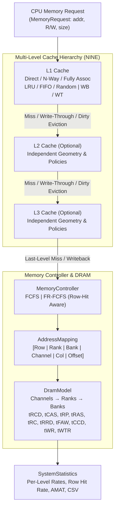
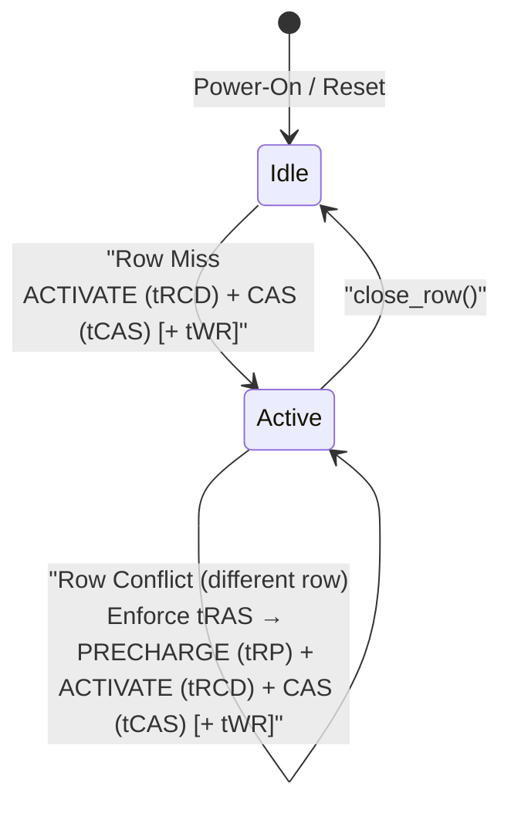
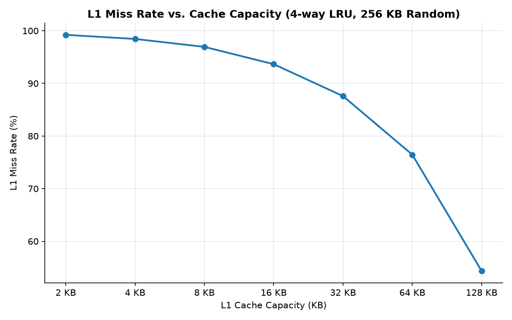
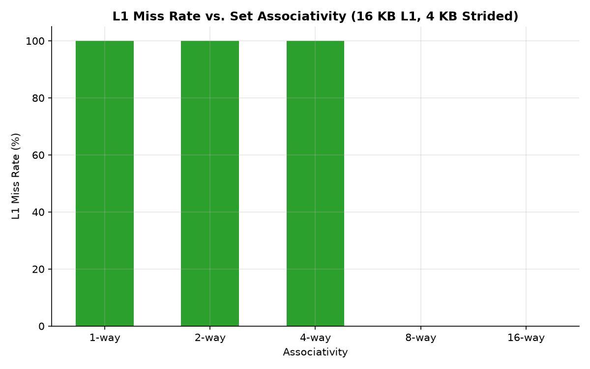
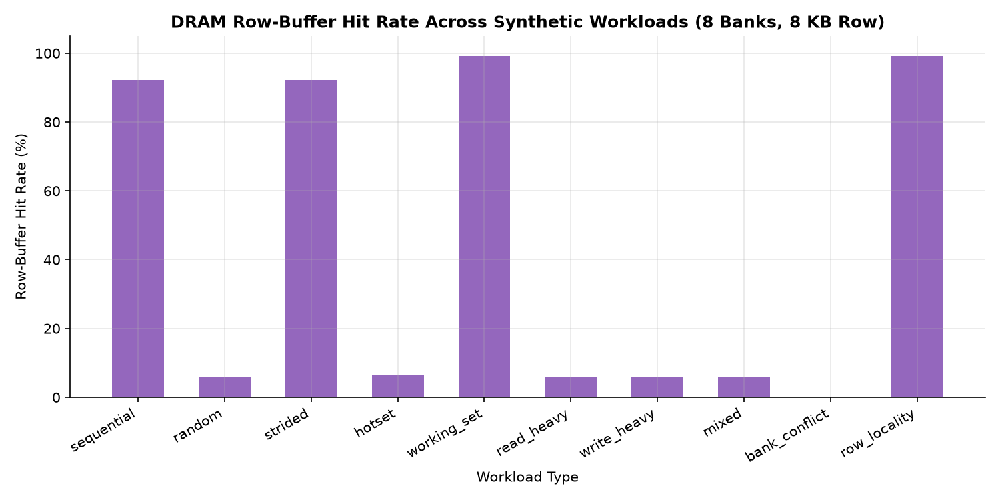
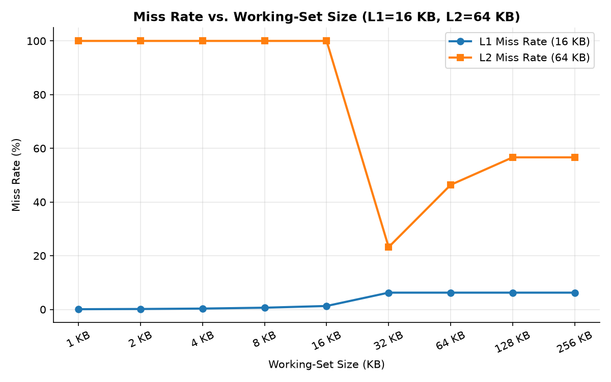
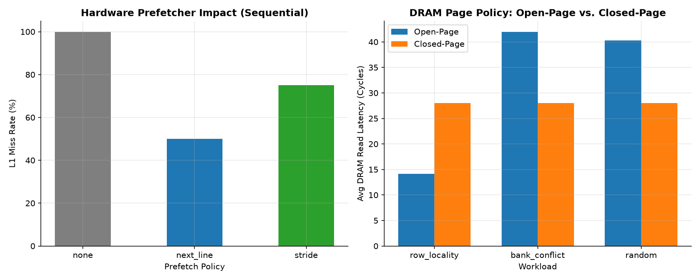

# DRAM & Cache Memory Simulator

[](https://en.cppreference.com/w/cpp/17)
[](https://cmake.org/)
[](tests/)
[](LICENSE)

A configurable, modular **C++17** memory-hierarchy and DRAM timing simulator with automated **Python** parameter sweeps and **Matplotlib** performance visualization.

---

## Overview & Motivation

Modern processor performance is heavily constrained by the *memory wall*—the growing latency and bandwidth gap between compute cores and main memory. This framework models a complete memory hierarchy from CPU requests through configurable multi-level caches (`L1` → `L2` → optional `L3`) and a `MemoryController` (`FCFS` / `FR-FCFS`) down to a multi-channel, multi-rank, multi-bank DRAM subsystem with row-buffer state and JEDEC-style timing constraints.

Designed for computer architecture, memory-subsystem, and systems engineering workflows, every module is unit-tested with GoogleTest (`119` tests) and validated across reproducible 66-configuration experiment sweeps.

---

## System Architecture



### DRAM Bank State Machine & Latency Model



---

## Key Features

- **Configurable Cache Levels (`Cache`, `CacheSet`, `CacheLine`, `CacheConfig`)**
  - Direct-mapped, N-way set-associative, and fully associative geometries (power-of-two `line_size_bytes` and `num_sets`).
  - Replacement policies: **LRU**, **FIFO**, and deterministic **Random** (`std::mt19937`).
  - Write policies: **Write-Back** and **Write-Through**, paired with **Write-Allocate** and **No-Write-Allocate**.
  - Per-level counters: total/read/write accesses, hits, misses (**3C Compulsory vs. Conflict/Capacity**), hit/miss rates, evictions, dirty evictions, writebacks, prefetches issued, and bytes transferred.
  - **Hardware Prefetching**: Configurable `NextLine` and `Stride` prefetchers with configurable prefetch degree.
- **Multi-Level Cache Hierarchy (`CacheHierarchy`)**
  - Configurable L1, L2, and optional L3 levels (or DRAM-only with 0 cache levels).
  - Non-inclusive, non-exclusive (NINE) fill/eviction model with dirty-eviction propagation and recursive **AMAT** calculation.
- **DRAM Organization, Timing, Refresh & Energy (`DramModel`, `DramBank`, `DramConfig`)**
  - Configurable channels, ranks, banks, rows, columns, and row-buffer size.
  - Row-interleaved mapping: `[row | rank | bank | channel | column | byte-offset]`.
  - **Row-Buffer Policies**: `OpenPage` vs. `ClosedPage` (auto-precharge).
  - Enforces `tRCD`, `tCAS`, `tRP`, `tRAS`, `tRC`, `tRRD`, `tFAW`, `tCCD`, `tWR`, rank-level `tWTR`, and optional periodic refresh (`tREFI` / `tRFC`).
  - Analytical per-command energy model (`energy_activate_pj`, `energy_precharge_pj`, `energy_read_pj`, `energy_write_pj`, `energy_refresh_pj` → nJ) with **DDR4-2400**, **DDR5-4800**, and **HBM3** presets.
- **Memory Controller (`MemoryController`)**
  - Supports **FCFS** and **FR-FCFS** (First-Ready, First-Come, First-Served) querying live bank state via `DramModel::is_row_open()`, plus `enqueue()`/`drain()` batch scheduling.
- **Trace Loader & 10 Synthetic Workloads**
  - Human-readable trace format (`R|W <hex_or_dec_addr> [size]`) with `#` comments and error reporting.
  - 10 reproducible workloads: `sequential`, `random`, `strided`, `hotset`, `working_set`, `read_heavy`, `write_heavy`, `mixed`, `bank_conflict`, `row_locality`.
- **Automated Experiments & Visualization**
  - `scripts/run_experiments.py` executes 66 configurations across 9 parameter sweeps and writes CSV + JSON manifests.
  - `scripts/plot_results.py` generates 9 publication-quality Matplotlib figures directly from CSV.

---

## Experimental Results

Generated from actual simulator runs (`20,000` requests/config, seed `42`) via [`run_experiments.py`](scripts/run_experiments.py) and [`plot_results.py`](scripts/plot_results.py):

| L1 Miss Rate vs. Capacity | Set Associativity Cliff (16 KB L1, 4 KB Stride) |
|---|---|
|  |  |

| DRAM Row-Buffer Hit Rate Across Workloads | Working-Set Size vs. Miss Rate |
|---|---|
|  |  |

| Hardware Prefetcher & DRAM Page Policy (`10_prefetch_and_page_policy.png`) |
|---|
|  |

---

## Building (Windows & Linux)

### Linux (GCC / Clang)
```bash
cmake -B build -DCMAKE_BUILD_TYPE=Release -DBUILD_TESTS=ON
cmake --build build -j$(nproc)
ctest --test-dir build --output-on-failure
```

### Windows (MinGW-w64 / PowerShell)
```powershell
cmake -B build -G "MinGW Makefiles" -DCMAKE_BUILD_TYPE=Release -DBUILD_TESTS=ON
cmake --build build -j 4
ctest --test-dir build --output-on-failure
```

---

## Usage Examples

Run with a trace file and FR-FCFS controller scheduling:
```bash
./build/memory_sim --trace workloads/sequential.trace --l1-size 16384 --l1-assoc 4 --l2-size 262144 --replacement lru --write-policy wb --dram-policy fr_fcfs
```

Run with a synthetic workload and export CSV:
```bash
./build/memory_sim --workload random --count 50000 --l1-size 32768 --l2-size 262144 --csv results/run.csv --verbose
```

Reproduce the full 66-configuration experiment suite and plots:
```bash
python scripts/run_experiments.py --count 20000 --seed 42 --output results/experiments.csv --overwrite
python scripts/plot_results.py --input results/experiments.csv --out-dir results/plots
```

---

## CLI Reference

| Option | Description | Default |
|---|---|---|
| `--trace <file>` | Load memory trace file | *(none)* |
| `--workload <type>` | Synthetic workload (`sequential`, `random`, `strided`, `hotset`, `working_set`, `read_heavy`, `write_heavy`, `mixed`, `bank_conflict`, `row_locality`) | `sequential` |
| `--count <n>` | Number of synthetic requests | `10000` |
| `--address-space <n>` | Address space size in bytes | `1048576` |
| `--stride <n>` | Stride in bytes for `sequential`/`strided` | `64` |
| `--read-ratio <f>` | Read fraction `0.0–1.0` | `0.8` |
| `--seed <n>` | RNG seed for reproducibility | `42` |
| `--working-set <n>` | Working-set size in bytes | `4096` |
| `--l1-size <n>` | L1 capacity in bytes | `32768` |
| `--l1-assoc <n>` | L1 associativity | `8` |
| `--l1-line-size <n>` | Cache line size in bytes (power of 2) | `64` |
| `--l1-latency <n>` | L1 hit latency (cycles) | `1` |
| `--replacement <p>` | `lru`, `fifo`, `random` | `lru` |
| `--write-policy <p>` | `wb` (write-back), `wt` (write-through) | `wb` |
| `--alloc-policy <p>` | `wa` (write-allocate), `nwa` (no-write-allocate) | `wa` |
| `--l2-size <n>` | L2 capacity in bytes | `262144` |
| `--l2-assoc <n>` | L2 associativity | `8` |
| `--l2-latency <n>` | L2 hit latency (cycles) | `10` |
| `--no-l2` | Disable L2 cache | enabled |
| `--l3-size <n>` | L3 capacity in bytes (`0` = disabled) | `0` |
| `--l3-assoc <n>` | L3 associativity | `16` |
| `--l3-latency <n>` | L3 hit latency (cycles) | `40` |
| `--dram-banks <n>` | DRAM banks per rank | `8` |
| `--dram-rows <n>` | Rows per DRAM bank | `32768` |
| `--dram-row-size <n>` | DRAM row-buffer size in bytes | `8192` |
| `--dram-tRCD <n>` | Row-to-column delay (cycles) | `14` |
| `--dram-tCAS <n>` | Column access latency (cycles) | `14` |
| `--dram-tRP <n>` | Row precharge latency (cycles) | `14` |
| `--dram-policy <p>` | Controller scheduling: `fcfs`, `fr_fcfs` | `fcfs` |
| `--csv <file>` | Write statistics CSV output | *(none)* |
| `--verbose` | Enable progress logging | `false` |

---

## Documentation

- [docs/ARCHITECTURE.md](docs/ARCHITECTURE.md) — Module layout, address decomposition, and data flow
- [docs/DESIGN_DECISIONS.md](docs/DESIGN_DECISIONS.md) — Modeling trade-offs, NINE policy, and simplifications
- [docs/VALIDATION.md](docs/VALIDATION.md) — Test suite, invariants, and verification methodology
- [docs/EXPERIMENTS.md](docs/EXPERIMENTS.md) — Experimental methodology and metric definitions

## Known Limitations

- Single-core, serialized request-by-request timing (no out-of-order MSHR concurrency or cache-coherence protocol).
- Unified L1 cache (no split L1-I / L1-D).
- `MemoryController` processes each cache-miss / writeback request as it arrives in the serialized hierarchy loop rather than batching concurrent MSHRs (batch reordering is supported via `enqueue()` / `drain()`).
- `DramConfig::tRFC` (periodic DRAM refresh) is validated as a configuration parameter but periodic refresh stalls are not yet scheduled on the active path.

## License

MIT License — see [LICENSE](LICENSE).
